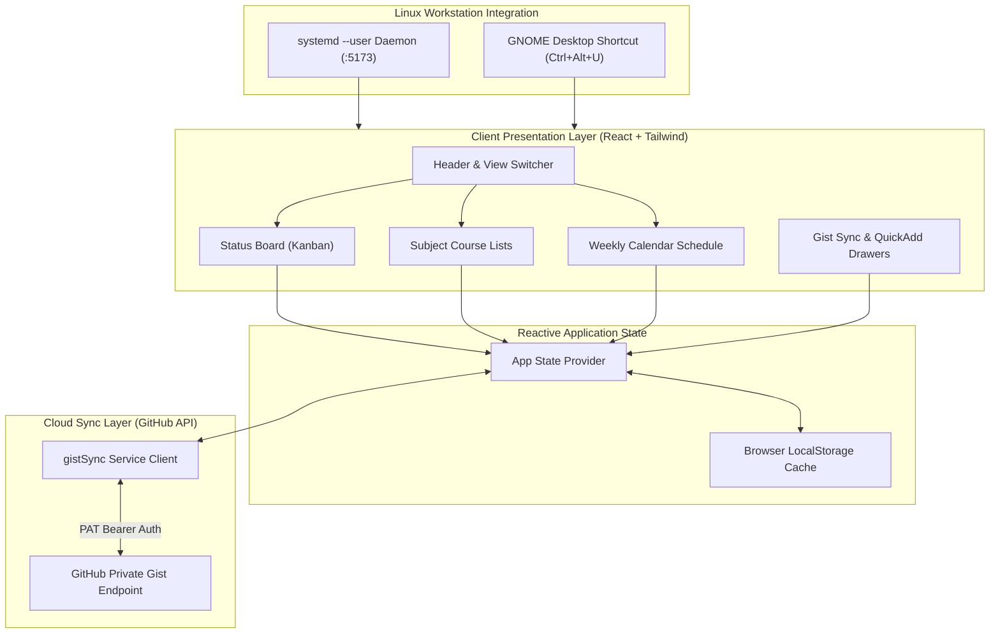

# MyKanban: Academic Task & Schedule Management Platform

> A lightweight, minimalist academic planner and course task dashboard inspired by Google Tasks and Google Calendar aesthetics, featuring high-framerate drag-and-drop, dual themes, private GitHub Gist cloud synchronization, and background systemd service automation.

[](https://nurjaks.github.io/MyKanban/)
[](https://react.dev/)
[](https://www.typescriptlang.org/)
[](https://vitejs.dev/)
[](https://tailwindcss.com/)
[](LICENSE)

---

## Overview & Concept

**MyKanban** provides a distraction-free environment for university students and engineers balancing coursework, assignments, and deadlines. Designed around the clean visual grammar of Google productivity tools, it eliminates complex project-management bloat in favor of immediate task entry, responsive scheduling, and zero-latency state transitions.

### Key Capabilities

- **Google Workspace Aesthetic**:
  - Circular animated completion toggles with smooth transition physics.
  - Native date badges indicating urgent states (*Today*, *Tomorrow*, *Overdue*).
  - Smooth 60fps drag-and-drop interactions across status lists and course lanes.
- **Adaptive Dual Themes**:
  - **Dark Mode**: Neutral dark foundation (`#131314`), surface layers (`#1e1f20`), and Google accent blue (`#8ab4f8`).
  - **Light Mode**: Crisp clean base (`#f8fafd`), elevated cards (`#ffffff`), and contrast blue (`#0b57d0`).
  - Persisted dynamically in browser storage with instant toggle controls.
- **Three Core Planning Views**:
  1. **Status Board**: Three-column Kanban board (*To Do*, *In Progress*, *Completed*) for general progress tracking.
  2. **Course Lists View**: Seven distinct subject columns displaying class times, lesson types, Google Calendar color chips, and homework queues.
  3. **Schedule Calendar**: 7-day weekly schedule integrating regular class timetables with upcoming assignment deadlines.
- **Serverless Cloud Synchronization (GitHub Gist)**:
  - Synchronize tasks and subjects across multiple workstations using personal GitHub access tokens and private GitHub Gists.
  - No external backend or proprietary cloud database required.
- **Linux Workstation Integration**:
  - Automated desktop background execution via user-level `systemd` unit.
  - System-wide global shortcut (`Ctrl + Alt + U`) for instant browser launcher.

---

## System Architecture



---

## Directory Structure

```
my-university-kanban/
├── .github/
│   └── workflows/
│       └── deploy.yml          # GitHub Pages CI/CD automated deployment
├── src/
│   ├── components/             # UI Views, Drawers, Headers and Modals
│   │   ├── CalendarView.tsx
│   │   ├── GoogleHeader.tsx
│   │   ├── GoogleTaskItem.tsx
│   │   ├── QuickAddBar.tsx
│   │   ├── StatusBoardView.tsx
│   │   ├── SubjectListsView.tsx
│   │   ├── SyncModal.tsx
│   │   └── TaskEditDrawer.tsx
│   ├── context/                # Global React context and task reducers
│   ├── data/                   # Default subjects, schedule, and seed data
│   ├── services/
│   │   └── gistSync.ts         # GitHub Gist synchronization engine
│   ├── types/                  # TypeScript interfaces and domain models
│   ├── utils/                  # Date helpers and storage utilities
│   ├── App.tsx                 # Root application component
│   ├── main.tsx                # React DOM entry point
│   └── index.css               # Tailwind directives and theme definitions
├── public/                     # Static assets and icons
├── vite.config.ts              # Vite bundle configuration
├── tailwind.config.js          # Design system color scales and tokens
└── package.json                # Project dependencies and run scripts
```

---

## Getting Started

### Prerequisites

- Node.js 18+ LTS
- npm or pnpm

### Local Installation & Startup

```bash
# Clone the repository
git clone https://github.com/NURJAKS/MyKanban.git
cd MyKanban

# Install project dependencies
npm install

# Start local development server
npm run dev
```

Visit `http://localhost:5173` in your browser.

### Production Build

```bash
# Build production bundle with type checking
npm run build

# Preview build artifact locally
npm run preview
```

---

## Cloud Synchronization Setup

To sync your schedule and assignments across devices:

1. Generate a **GitHub Personal Access Token (classic or fine-grained)** with `gist` scope permissions.
2. In the application header, click the **Cloud Sync** icon.
3. Paste your token and click **Create Initial Gist Backup** (or enter an existing Gist ID).
4. The system securely saves your configuration locally and performs bi-directional updates on demand.

---

## Linux Systemd Service Setup

To run MyKanban continuously on your workstation:

```bash
# Create user service definition
mkdir -p ~/.config/systemd/user
cat << 'EOF' > ~/.config/systemd/user/my-university-kanban.service
[Unit]
Description=My University Kanban Service
After=network.target

[Service]
Type=simple
WorkingDirectory=%h/.gemini/antigravity/scratch/my-university-kanban
ExecStart=/usr/bin/npm run dev
Restart=always
RestartSec=3

[Install]
WantedBy=default.target
EOF

# Reload daemon and activate service
systemctl --user daemon-reload
systemctl --user enable --now my-university-kanban.service
```

---

## License

This project is licensed under the [MIT License](LICENSE).
